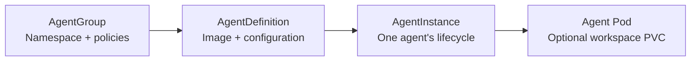

# AgentRally Operator

English | [简体中文](README.zh-CN.md)

**AgentRally deploys and manages containerized AI agents on Kubernetes.**

Run your agent images through `kubectl` or GitOps.
Applications own their model calls, tools, conversation state and APIs.

- Reuse configuration across multiple AgentInstances.
- Suspend, resume, restart and upgrade agents; prewarm spare capacity.
- Mount private or existing PVCs for workspace storage.
- Apply namespace policies and quotas, and select Kata Containers or gVisor through RuntimeClass.

## Resources



AgentGroup creates the namespace for its AgentDefinitions and AgentInstances.
One AgentDefinition can serve multiple independent AgentInstances.

## Quick start

### Dependency: agent-sandbox

Install [agent-sandbox](docs/installation.md#install-upstream-agent-sandbox) if it is not already present.

```sh
kubectl apply --server-side -f https://github.com/kubernetes-sigs/agent-sandbox/releases/download/v1.0.5/sandbox-with-extensions.yaml && kubectl -n agent-sandbox-system rollout status deployment/agent-sandbox-controller --timeout=180s
```

### 1. Install the Operator

```sh
helm install agentrally-operator oci://ghcr.io/chizhang21/helm/agentrally-operator \
  --version 0.0.4 \
  -n agentrally-system --create-namespace --wait --timeout 5m
```

### 2. Start an Agent

```sh
git clone --branch v0.0.4 --depth 1 https://github.com/chizhang21/agentrally-operator.git
cd agentrally-operator
kubectl apply -f examples/02-group.yaml && kubectl wait agentgroup/demo --for=condition=Ready --timeout=120s
kubectl apply -f examples/03-definition.yaml -f examples/04-instance-basic.yaml && kubectl -n agentrally-demo wait agentinstance/demo-agent --for=condition=Ready --timeout=300s
```

The [AgentDefinition](examples/03-definition.yaml) runs a public demo image that returns
a fixed response without model credentials.

### 3. Call the Agent

```sh
POD=$(kubectl -n agentrally-demo get agentinstance demo-agent -o jsonpath='{.status.podName}')
kubectl -n agentrally-demo port-forward "pod/$POD" 18080:8080
```

In another terminal:

```sh
curl -fsS http://127.0.0.1:18080/healthz
curl -fsS http://127.0.0.1:18080/chat -H 'Content-Type: application/json' --data '{"message":"Hello"}'
```

Chat response:

```json
{"response":"AgentRally demo agent is ready.","mode":"demo"}
```

For real model configuration, see the
[demo Agent project](https://github.com/chizhang21/agentrally-examples/tree/main/operator/http-api-agent).

### 4. Suspend and resume

Suspend:

```sh
kubectl -n agentrally-demo patch agentinstance demo-agent --type=merge -p '{"spec":{"operatingMode":"Suspended"}}' && kubectl -n agentrally-demo wait agentinstance/demo-agent --for=condition=Suspended --timeout=120s
```

Resume:

```sh
kubectl -n agentrally-demo patch agentinstance demo-agent --type=merge -p '{"spec":{"operatingMode":null}}' && kubectl -n agentrally-demo wait agentinstance/demo-agent --for=condition=Ready --timeout=300s
```

After resuming, repeat [step 3](#3-call-the-agent) with the new Pod.

### 5. Clean up

```sh
kubectl delete -f examples/04-instance-basic.yaml --timeout=300s
kubectl delete -f examples/03-definition.yaml --timeout=120s
kubectl delete -f examples/02-group.yaml --timeout=300s
```

Uninstall the Operator (optional):

```sh
helm uninstall agentrally-operator -n agentrally-system
```

Helm retains the CRDs.

## Run your own agent

Adapt the [AgentGroup](examples/02-group.yaml), [AgentDefinition](examples/03-definition.yaml)
and [AgentInstance](examples/04-instance-basic.yaml) examples:

1. Create or reuse a ready AgentGroup.
   Use its namespace for application resources.
2. Set the AgentDefinition's image, command, environment, resources, ports and probes.
   The Restricted examples require an image that supports non-root execution.
3. Create and reference any Secrets, ConfigMaps and image pull credentials.
4. Apply the AgentDefinition, then create an AgentInstance with a new name
   and `spec.definitionRef.name` pointing to it.

For existing AgentInstances, follow the [upgrade steps](docs/usage.md#lifecycle).

| Need | Configure |
| --- | --- |
| Workspace storage | `AgentInstance.spec.workspace`: `volumeClaimTemplate` or `existingClaimRef`. |
| HTTP access | `AgentInstance.spec.interaction` with a Gateway. Authentication belongs to the agent or ingress. |
| Prewarming | AgentDefinition and AgentGroup [pool settings](docs/agent-templates.md#allocation-and-policy). |
| Custom Pod layout | Optional `SandboxTemplate`: [sandbox-template.yaml](examples/sandbox-template.yaml). |

Adapt storage and Gateway settings in the [full AgentInstance example](examples/04-instance-full.yaml).
Complete applications:
[agentrally-examples/operator](https://github.com/chizhang21/agentrally-examples/tree/main/operator).

## Runtime isolation

Kata Containers provides a guest-kernel VM per Pod sandbox.
Its VM or microVM configuration depends on the installed VMM.
gVisor provides a userspace application kernel.

Select an installed RuntimeClass in AgentDefinition:

```yaml
spec:
  container:
    runtimeClassName: kata # Replace with your cluster's actual RuntimeClass name.
```

Omitting the field uses the node's default runtime.
List classes with `kubectl get runtimeclasses`.
See [runtime configuration](docs/agent-templates.md#container-runtime) for template and update details.

## Lifecycle behavior

| Operation | Execution | Workspace data |
| --- | --- | --- |
| Suspend and resume | Recreate the Pod within the same Sandbox. | Private and existing PVCs remain. Memory and ephemeral files are lost. |
| Restart or upgrade | Replace the Sandbox and its Pod. | Private PVCs are replaced. An existing PVC remains. |
| Delete an AgentInstance | Remove its execution resources. | Private PVCs are removed. An existing PVC remains. |

Use `workspace.existingClaimRef` when data must survive a restart, upgrade or AgentInstance deletion.

AgentGroup deletion reports `GroupInUse` until its AgentDefinitions, AgentInstances,
execution resources and PVCs are removed.

AgentDefinition edits leave existing AgentInstances on their accepted revision.
Restarts keep that revision; upgrades require a new `spec.revision` and `restartToken`.
See [Lifecycle](docs/usage.md#lifecycle) for commands and execution expiry settings.

### Observed timings

Quick-start Demo defaults on single-node Kind/runc (8 CPUs, 31 GiB RAM), with cached images.
Five samples per operation; private PVCs use local-path storage with a 32 MiB request.

| Operation | Median (s) | Observed range (s) |
| --- | --- | --- |
| Cold start, no PVC | 9.0 | 8.9–9.1 |
| Prewarmed allocation, no PVC | 1.1 | 0.7–1.1 |
| Cold start, private PVC | 13.5 | 13.1–14.6 |
| Suspend, private PVC | 2.6 | 2.2–2.9 |
| Resume, private PVC | 9.0 | 8.7–9.0 |

Startup and resume run from command invocation to observed `Ready=True`.
Suspension ends at `Suspended=True` with the old Pod removed.
Prewarmed allocation starts with a ready spare Pod; these measurements exclude model inference.

## If an AgentInstance does not become ready

```sh
kubectl -n agentrally-demo describe agentinstance demo-agent
```

Check Conditions and Events against the [diagnostics guide](docs/usage.md#readiness-reasons).

## Documentation

| Topic | Guide |
| --- | --- |
| Installation and Helm values | [Installation](docs/installation.md) · [Values examples](examples/values) |
| Agent configuration and operations | [Usage](docs/usage.md) |
| Resource examples | [Examples](examples) |
| Templates and prewarming | [Agent templates](docs/agent-templates.md) |
| Runtime, storage and network discovery | [Cluster capabilities](docs/cluster-capabilities.md) |
| Architecture | [Architecture](docs/architecture.md) |
| Development | [Development](docs/development.md) |
| Orchestrator integration | [Values](examples/values/orchestrator.yaml) · [Connector protocol](docs/outbound-connector.md) |

## Project status

The API is **alpha**.

Network isolation requires a configured NetworkPolicy and an enforcing CNI.

## License

Licensed under [Apache-2.0](LICENSE).
Third-party attribution is in [NOTICE](NOTICE).
