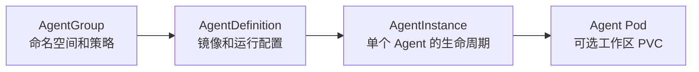

# AgentRally Operator

[English](README.md) | 简体中文

**AgentRally 用于在 Kubernetes 上部署 Agent 容器，并管理它们的配置和生命周期。**

通过 `kubectl` 或 GitOps 运行自己的 Agent 镜像。
模型调用、工具、对话状态和应用 API 由 Agent 自身实现。

- 多个 AgentInstance 复用同一份配置。
- 挂起、恢复、重启、升级 Agent，并预热备用容量。
- 挂载私有 PVC 或已有 PVC 作为工作区。
- 配置命名空间策略和配额，通过 RuntimeClass 选择 Kata Containers 或 gVisor。

## 资源



AgentGroup 创建命名空间，供其 AgentDefinition 和 AgentInstance 使用。
一个 AgentDefinition 可供多个独立的 AgentInstance 使用。

## 快速开始

### 依赖：agent-sandbox

集群尚未安装 [agent-sandbox](docs/installation.md#install-upstream-agent-sandbox) 时，先执行：

```sh
kubectl apply --server-side -f https://github.com/kubernetes-sigs/agent-sandbox/releases/download/v1.0.5/sandbox-with-extensions.yaml && kubectl -n agent-sandbox-system rollout status deployment/agent-sandbox-controller --timeout=180s
```

### 1. 安装 Operator

```sh
helm install agentrally-operator oci://ghcr.io/chizhang21/helm/agentrally-operator \
  --version 0.0.3 \
  -n agentrally-system --create-namespace --wait --timeout 5m
```

### 2. 启动 Agent

```sh
git clone --branch v0.0.3 --depth 1 https://github.com/chizhang21/agentrally-operator.git
cd agentrally-operator
kubectl apply -f examples/02-group.yaml && kubectl wait agentgroup/demo --for=condition=Ready --timeout=120s
kubectl apply -f examples/03-definition.yaml -f examples/04-instance-basic.yaml && kubectl -n agentrally-demo wait agentinstance/demo-agent --for=condition=Ready --timeout=300s
```

[AgentDefinition](examples/03-definition.yaml) 使用公开的 Demo 镜像，返回固定内容，无需模型凭证。

### 3. 调用 Agent

```sh
POD=$(kubectl -n agentrally-demo get agentinstance demo-agent -o jsonpath='{.status.podName}')
kubectl -n agentrally-demo port-forward "pod/$POD" 18080:8080
```

在另一个终端执行：

```sh
curl -fsS http://127.0.0.1:18080/healthz
curl -fsS http://127.0.0.1:18080/chat -H 'Content-Type: application/json' --data '{"message":"Hello"}'
```

聊天响应：

```json
{"response":"AgentRally demo agent is ready.","mode":"demo"}
```

接入真实模型见 [Demo Agent 项目](https://github.com/chizhang21/agentrally-examples/tree/main/operator/http-api-agent)。

### 4. 挂起和恢复

挂起：

```sh
kubectl -n agentrally-demo patch agentinstance demo-agent --type=merge -p '{"spec":{"operatingMode":"Suspended"}}' && kubectl -n agentrally-demo wait agentinstance/demo-agent --for=condition=Suspended --timeout=120s
```

恢复：

```sh
kubectl -n agentrally-demo patch agentinstance demo-agent --type=merge -p '{"spec":{"operatingMode":null}}' && kubectl -n agentrally-demo wait agentinstance/demo-agent --for=condition=Ready --timeout=300s
```

恢复后重复[第 3 步](#3-调用-agent)，获取新 Pod 并重新转发端口。

### 5. 清理资源

```sh
kubectl delete -f examples/04-instance-basic.yaml --timeout=300s
kubectl delete -f examples/03-definition.yaml --timeout=120s
kubectl delete -f examples/02-group.yaml --timeout=300s
```

卸载 Operator（可选）：

```sh
helm uninstall agentrally-operator -n agentrally-system
```

Helm 会保留 CRD。

## 运行自己的 Agent

修改 [AgentGroup](examples/02-group.yaml)、[AgentDefinition](examples/03-definition.yaml)
和 [AgentInstance](examples/04-instance-basic.yaml) 示例：

1. 创建或复用一个就绪的 AgentGroup。
   应用资源均放在其命名空间中。
2. 修改 AgentDefinition 的镜像、命令、环境变量、资源、端口和健康检查。
   示例采用 Restricted 配置，镜像需支持非 root 运行。
3. 创建所需的 Secret、ConfigMap 和镜像拉取凭据，并在 AgentDefinition 中引用。
4. 应用 AgentDefinition，再用新名称创建 AgentInstance，
   将 `spec.definitionRef.name` 指向该 AgentDefinition。

更新已有 AgentInstance 时，按[升级步骤](docs/usage.md#lifecycle)操作。

| 需求 | 配置方式 |
| --- | --- |
| 工作区存储 | `AgentInstance.spec.workspace`：`volumeClaimTemplate` 或 `existingClaimRef`。 |
| HTTP 访问 | `AgentInstance.spec.interaction`，需 Gateway。认证由 Agent 或入口设施提供。 |
| 预热 | AgentDefinition 和 AgentGroup 的[池配置](docs/agent-templates.md#allocation-and-policy)。 |
| 自定义 Pod 布局 | 可选 `SandboxTemplate`，参考 [sandbox-template.yaml](examples/sandbox-template.yaml)。 |

使用[完整 AgentInstance 示例](examples/04-instance-full.yaml)时，需适配存储和 Gateway 配置。
完整应用示例：
[agentrally-examples/operator](https://github.com/chizhang21/agentrally-examples/tree/main/operator)。

## 运行时隔离

Kata Containers 为每个 Pod 沙箱提供独立虚拟机和客户机内核。
VM 或 microVM 的具体形态取决于已安装的 VMM。
gVisor 在用户态提供沙箱应用内核。

在 AgentDefinition 中选择已安装的 RuntimeClass：

```yaml
spec:
  container:
    runtimeClassName: kata # 替换为集群中实际存在的 RuntimeClass 名称。
```

省略该字段时使用节点默认运行时。
使用 `kubectl get runtimeclasses` 查看可用名称。
模板及变更配置见[运行时配置](docs/agent-templates.md#container-runtime)。

## 生命周期行为

| 操作 | 执行资源 | 工作区数据 |
| --- | --- | --- |
| 挂起和恢复 | 在同一 Sandbox 中删除并重建 Pod。 | 私有 PVC 和已有 PVC 均保留，内存和临时文件丢失。 |
| 重启或升级 | 替换 Sandbox 及其 Pod。 | 私有 PVC 被替换，已有 PVC 保留。 |
| 删除 AgentInstance | 清理该实例的执行资源。 | 私有 PVC 被删除，已有 PVC 保留。 |

需要在重启、升级或删除 AgentInstance 后保留数据时，使用 `workspace.existingClaimRef`。

删除 AgentGroup 前需清理其中的 AgentDefinition、AgentInstance、执行资源和 PVC，否则报告 `GroupInUse`。

修改 AgentDefinition 不会自动升级已有 AgentInstance。
重启保留已接受的版本，升级需设置新的 `spec.revision` 和 `restartToken`。
操作命令及执行到期配置见[生命周期](docs/usage.md#lifecycle)。

### 实测耗时

快速开始 Demo 的默认配置，单节点 Kind/runc（8 CPU、31 GiB 内存），镜像已缓存。
每项采样 5 次；私有 PVC 使用 local-path 存储，申请容量为 32 MiB。

| 操作 | 中位数（秒） | 观测范围（秒） |
| --- | --- | --- |
| 冷启动，无 PVC | 9.0 | 8.9–9.1 |
| 预热分配，无 PVC | 1.1 | 0.7–1.1 |
| 冷启动，私有 PVC | 13.5 | 13.1–14.6 |
| 挂起，私有 PVC | 2.6 | 2.2–2.9 |
| 恢复，私有 PVC | 9.0 | 8.7–9.0 |

启动和恢复统计命令发起到观测到 `Ready=True` 的时间。
挂起统计到 `Suspended=True` 且旧 Pod 已删除。
预热分配从备用 Pod 已就绪时开始计时；以上均不包含模型推理。

## AgentInstance 未就绪时

```sh
kubectl -n agentrally-demo describe agentinstance demo-agent
```

结合 Conditions、Events 和[诊断指南](docs/usage.md#readiness-reasons)排查。

## 文档

| 内容 | 文档 |
| --- | --- |
| 安装和 Helm 配置 | [安装指南](docs/installation.md) · [Values 示例](examples/values) |
| Agent 配置和运维 | [使用指南](docs/usage.md) |
| 资源示例 | [示例](examples) |
| 模板和预热 | [Agent 模板](docs/agent-templates.md) |
| 运行时、存储和网络发现 | [集群能力](docs/cluster-capabilities.md) |
| 架构 | [架构](docs/architecture.md) |
| 开发 | [开发指南](docs/development.md) |
| Orchestrator 集成 | [Values](examples/values/orchestrator.yaml) · [出站 Connector](docs/outbound-connector.md) |

## 项目状态

当前 API 为 **alpha**。

网络隔离需要配置 NetworkPolicy，并由支持它的 CNI 执行。

## 许可证

项目使用 [Apache-2.0](LICENSE) 许可证，第三方声明见 [NOTICE](NOTICE)。
