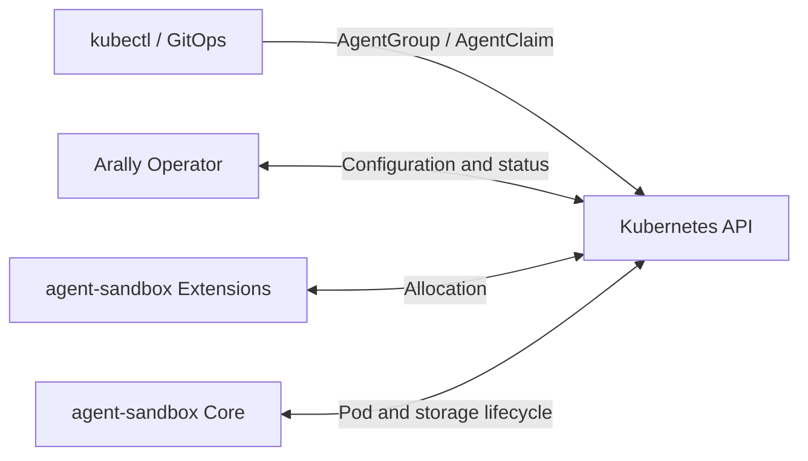
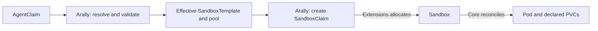
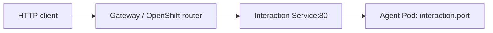

# Architecture

Arally manages containerized agent instances on Kubernetes and OpenShift. Users
declare an image, configuration and lifecycle; the Operator prepares the group's
namespace and policies, requests execution, and reports the observed state.
The agent application implements its own conversations, model calls, tools and API.

## Responsibilities

Arally exposes three resources in `arally.io/v1alpha1`:

| Resource | Scope | Responsibility |
| --- | --- | --- |
| AgentGroup | Cluster | Dedicated Namespace, Pod Security settings, optional quota and NetworkPolicy |
| AgentClaim | Namespace | One agent's configuration, allocation, lifecycle requests and optional HTTP access |
| ClusterCapabilities | Cluster | Runtime, storage and network configuration evidence used by deployment checks |

AgentClaim execution requires agent-sandbox Core and Extensions.
Arally manages configuration and allocation requests. agent-sandbox Extensions
allocates Sandboxes and refills warm pools. agent-sandbox Core manages their Pods,
declared PVCs and optional headless Services. Kubernetes stores desired state and
status; each controller reads and writes resources through the Kubernetes API.

The Operator runs independently of a backend. Users supply agent images, source
SandboxTemplates, Secrets and ServiceAccounts. Arally reads these references and
resolves configuration without modifying the supplied resources.

## Provisioning and prewarming

An AgentClaim follows one allocation path, whether a warm instance is available
or execution must start from scratch:

1. Check Group readiness and ownership of its namespace.
2. Resolve a built-in environment or source SandboxTemplate. Apply runtime,
   model, workspace and security settings; check references and capabilities.
3. Persist the desired revision and pool selection. For managed capacity, create
   a Group-owned template snapshot and pool; validate an existing external pool.
4. Create the allocation SandboxClaim. Verify the assigned Sandbox's ownership
   and configuration before accepting the allocation.
5. Request the operating mode, reconcile optional HTTP access, and observe Core
   and the owned Pod to report configuration, health and readiness.

Matching configurations share capacity within a Group. Pool identity includes
Group UID, template source, resolved configuration, selected Agent container and
reference resource versions. PVC specifications participate in that identity;
instance-specific PVC names do not. Generated templates are create-only snapshots.
External pools are validated without adoption or modification.

With ready spares, Extensions transfers an existing Sandbox to the allocation
Claim, preserving its Pod and private PVCs, then refills the pool. Otherwise it
creates a new Sandbox. Core provisions each Sandbox's declared PVCs, including
those of unassigned spares. With private PVC templates, matching agents share
capacity while keeping their workspace files separate.

New managed pools default to zero spares. Administrators can scale them, and
Arally preserves the configured count. A spare starts the real application with
its configured credentials and consumes compute and storage before allocation.
See [pool policy](agent-templates.md#allocation-and-policy) for configuration.

The allocation budget is persisted in status and ends at validated Sandbox
assignment. Pod startup is observed separately. Manager restarts do not reset the
budget; an unassigned attempt that times out is cleaned up and requires a new
`restartToken`. An initially suspended Claim waits for resume before allocating.

## Resources and ownership

Owner references define the hierarchy used for garbage collection. Arally also
checks ownership before updating managed resources or accepting execution observations.

| Resource | Reconciled by | Controller owner |
| --- | --- | --- |
| Group Namespace, quota and NetworkPolicy | Arally | AgentGroup |
| Generated SandboxTemplates and SandboxWarmPools | Arally | AgentGroup |
| Allocation SandboxClaim, interaction Service and route | Arally | AgentClaim |
| Unassigned warm Sandbox | Extensions | SandboxWarmPool |
| Assigned Sandbox | Extensions | Allocation SandboxClaim |
| Execution Pod, private PVCs and optional headless Service | Core | Sandbox |

AgentGroup creates an `arally-` namespace and rejects an unrelated existing one.
Claims must use their Group's namespace. Source templates, external pools and
referenced credentials remain user-managed.

The Group prunes generated pools and snapshots with no active AgentClaim or
native SandboxClaim references, waiting for pool deletion before removing its
snapshot. Claim replacement, expiry and deletion request foreground deletion of
the owned SandboxClaim; upstream controllers and garbage collection remove the
execution. Group deletion waits for AgentClaims, Sandboxes and PVCs to be removed
before deleting the namespace.

Arally patches `operatingMode` on assigned Sandboxes and observes their Pods and
PVCs. Its RBAC grants Sandbox patch access without field-level restrictions;
Pod and PVC access is read-only.

## Lifecycle and workspace

An AgentClaim is the lasting declaration. Its Sandbox is a replaceable execution,
and each private workspace PVC belongs to that Sandbox. Suspend/resume preserves
the workspace within an execution; execution replacement creates a new workspace.

| Change | Execution behavior | Private workspace |
| --- | --- | --- |
| Edit execution configuration | Existing execution continues; a differing configuration requires explicit replacement | Unchanged |
| Suspend | Core removes the Pod and retains the Sandbox | Retained |
| Resume | Core starts a new Pod in the same Sandbox | Reused |
| Recreate a Pod within the same Sandbox | Pod changes; Sandbox remains | Reused |
| Change `restartToken` | Remove the old allocation, wait for cleanup, then allocate a replacement | Old PVCs removed; new PVCs provisioned |
| Expire execution or delete AgentClaim | Remove execution and interaction resources | Removed with the Sandbox |

Resume restores access to retained files; it does not restore process memory.
`Suspended=True` requires current Core confirmation and no remaining execution
Pod. A Pod still terminating keeps suspension or cleanup pending. Arally reports
stalls without force-deleting runtime resources.

Expiry with `shutdownPolicy: Retain` keeps the AgentClaim and diagnostics, while
removing execution and its workspace. Data that must outlive Sandbox replacement
needs storage managed independently of that execution. Custom templates can
reference [external PVCs](agent-templates.md#allocation-and-policy), whose access
and sharing constraints still apply. Operating commands and expiry settings are
in [lifecycle](usage.md#lifecycle).

## Access and trust

Control requests use the Kubernetes API. Optional HTTP traffic follows a separate
path through an existing Gateway or OpenShift router:

Arally creates an HTTPRoute or OpenShift Route to configure that path, plus a
ClusterIP Service targeting Core's published Pod selector. This Service is
separate from Core's optional headless Service. `InteractionReady` reflects
execution availability and route-controller acceptance, not an HTTP or
authentication probe. See [interaction endpoints](usage.md#interaction-endpoint).

Group NetworkPolicy uses the supplied Pod and namespace selectors. Enforcement
depends on the CNI; an allow rule authorizes matching Pods and does not require
traffic to pass through a Gateway. Pod Security defaults to Restricted. AnyUID
requires administrator-granted OpenShift SCC access; Arally cannot grant it.
See [group security](usage.md#group-namespace-and-security).

Secrets are fetched by explicit reference, without listing, watching or caching.
Configuration identity records reference versions rather than Secret contents.
The Operator's ClusterRole still permits GET across namespaces; Group namespace
checks are controller logic, not namespace-scoped Operator RBAC.

ClusterCapabilities reports configuration evidence. It does not run runtime,
storage I/O or traffic-enforcement tests. The default `cluster` report is always
enabled. See [capability checks](cluster-capabilities.md) for the evidence limits.

## Design decisions

| Decision | Reason | Tradeoff |
| --- | --- | --- |
| Delegate execution to agent-sandbox | Keep one owner of allocation, Pod and storage lifecycle | Requires compatible Core and Extensions APIs |
| Give each Group a dedicated namespace | Apply namespace policy and quota consistently | Requires cluster permissions; Group deletion waits for resources to be removed |
| Use one pool allocation path | Cold and warm instances share validation and lifecycle handling | Requires template snapshots, pool selection and unused-capacity cleanup |
| Snapshot execution configuration and require explicit replacement | Keep a running execution stable while desired settings change | Pod configuration updates wait for `restartToken`; replacement also replaces its private workspace |
| Provision a private PVC per Sandbox | Prepare independent storage before warm allocation | Spares consume disks; workspace lifetime ends with the execution |
| Default to zero spares | Let users decide when application startup and idle resource use are acceptable | Prewarming must be enabled explicitly |
| Persist revisions and allocation budgets in Kubernetes | Resume reconciliation after manager restarts | Progress depends on the API and upstream controllers; assignment and application readiness remain separate |

## Code organization

| Package | Responsibility |
| --- | --- |
| [cmd](../cmd) | Manager setup, controller registration, leader election and optional Connector startup |
| [internal/controller](../internal/controller) | CR-specific reconciliation, ownership checks, conditions, Events and watches |
| [internal/allocation](../internal/allocation) | Pool selection, snapshot creation and unused-capacity cleanup |
| [internal/podconfig](../internal/podconfig) | Creation markers and comparison of declared, snapshot and admitted Pod configuration |
| [internal/sandbox](../internal/sandbox) | Core and Extensions wire types and encoding |
| [internal/templates](../internal/templates) | Embedded environments and runtime overrides |
| [internal/capabilities](../internal/capabilities) | Configuration discovery and reports |
| [internal/diagnostics](../internal/diagnostics) | Safe messages with separately retained error causes |

A controller-runtime manager runs AgentGroup, AgentClaim and ClusterCapabilities
controllers in one process, using Lease leader election. The wire adapter uses
`agents.x-k8s.io/v1beta1` for Sandbox and `extensions.agents.x-k8s.io/v1beta1` for
templates, pools and Claims; it contains no upstream controller logic.

### Reconciliation and status

Controllers resume from observed state and persist status only when it changes.
Condition transitions emit Events after persistence. Pause requests on owned
execution and in-flight allocation deadlines run before desired-configuration
dependency gates, so a missing new reference does not prevent shutdown.

| Condition | Meaning |
| --- | --- |
| ConfigurationAccepted | Assigned Sandbox matches the resolved configuration. |
| ConfigurationApplied | Owned Pod's creation marker and observed configuration match the desired revision. |
| CapabilityValidated | References and available capability evidence were checked. |
| ProvisioningReady | An owned Sandbox matching the allocation snapshot was assigned; startup may still be pending. |
| Available | Current Core/Pod health, independent of an unapplied update. |
| Ready | Current desired configuration is applied and execution/requested endpoint are ready. |
| Suspended | Current Core confirmation of suspension with no remaining execution Pod. |
| Finished | Core confirms natural completion of the current owned Pod, excluding suspension and Pod deletion. |
| InteractionReady | Execution is available and the route controller accepted the endpoint. |

Generated Pods carry `ARALLY_CONFIGURATION_REVISION`. External warmed Pods without
a creation marker report unverified configuration. Reference changes are detected
through indexed dependency watches or periodic reconciliation; optional route APIs
use direct reads and polling, so their CRDs are not required at manager startup.
For operational interpretation, see [status and diagnostics](usage.md#status-and-diagnostics).

### Optional Connector

`connector.enabled` starts an outbound Connector worker in the elected Operator
process. The chart conditionally supplies its credentials and additional CR write
permissions. It relays requests for the three Arally CRs for future Orchestrator
integration. Protocol details are in [Outbound Connector](outbound-connector.md).

Installation, operating commands and build workflows are covered separately in
[installation](installation.md), [usage](usage.md) and [development](development.md).
