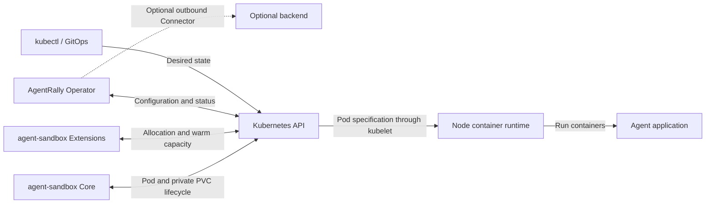
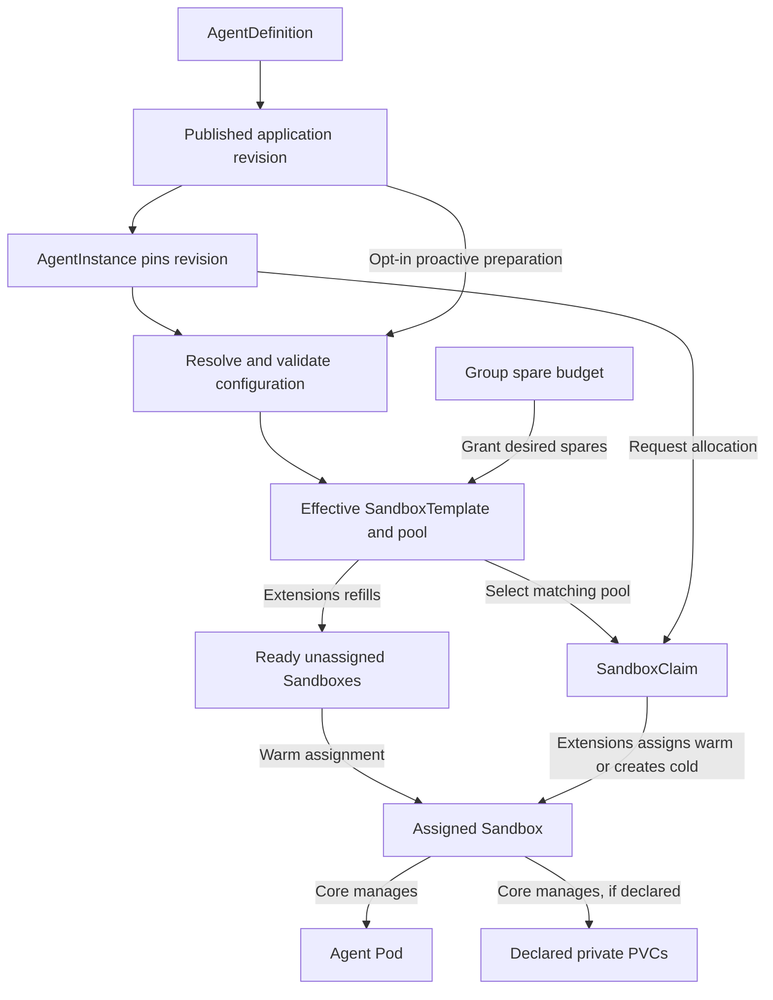
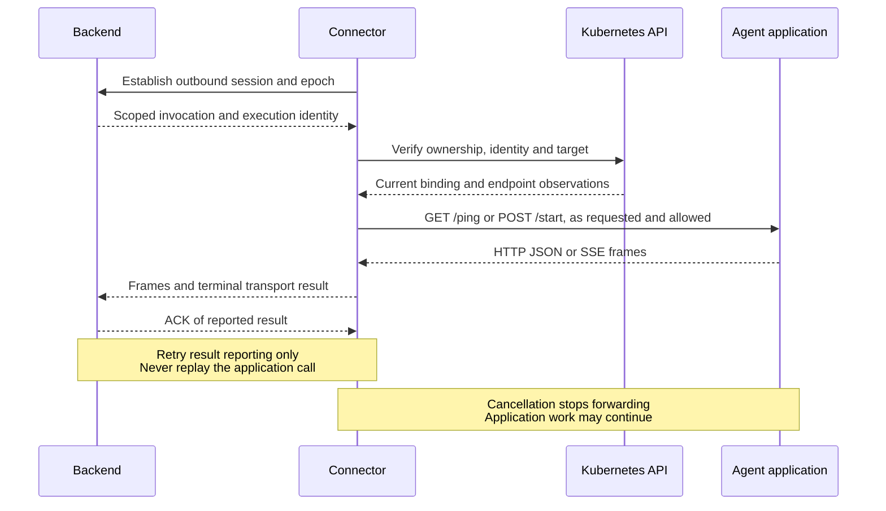

# Architecture

AgentRally manages the Kubernetes runtime for containerized agents.
Users declare reusable application configuration, instances and lifecycle intent.
The Operator prepares namespace policy, requests execution and reports observed state.

The agent application owns conversations, model calls, tools, channels and its API.
An external backend may add user identity, session routing and activity policies.
The Operator remains usable directly through Kubernetes.

Open the [interactive architecture explorer](architecture-explorer/index.html) to inspect
components, follow lifecycle steps and compare workspace ownership.
The standalone page works offline without a build step.

## Responsibilities

AgentRally exposes five resources in `arally.io/v1alpha1`:

| Resource | Scope | Responsibility |
| --- | --- | --- |
| AgentGroup | Cluster | Dedicated namespace, Pod Security, quota, LimitRange, NetworkPolicy and shared capacity policy |
| AgentDefinition | Namespace | Reusable application configuration, immutable published revisions and optional proactive spare capacity |
| AgentInstance | Namespace | Logical identity, accepted definition revision, workspace binding, lifecycle and optional HTTP access |
| AgentWorkspace | Cluster | Initial platform-managed persistent binding, pinned resource identities and release observation; preview |
| ClusterCapabilities | Cluster | Runtime, storage and network configuration evidence used by deployment checks |

A controller-runtime manager runs all five controllers in one Operator process.
Leader election coordinates active reconciliation.
The optional Connector runs in that same elected process.

Execution requires compatible agent-sandbox Core and Extensions installations.
AgentRally resolves configuration and creates allocation requests.
Extensions allocates Sandboxes and refills warm pools.
Core manages their Pods, declared private PVCs and optional headless Services.

The diagram shows logical responsibilities.
Controllers coordinate through the Kubernetes API rather than invoking one another.

RuntimeClass selects the node runtime for the Pod.
Kata can provide a guest VM; gVisor provides a userspace kernel.
These require a compatible runtime installed on the selected nodes.
AgentRally does not install a hypervisor or turn every Pod into a microVM.
Containers in the same runtime sandbox share that isolation boundary.

Users supply agent images, source SandboxTemplates, Secrets and ServiceAccounts.
AgentRally reads these references without modifying the supplied resources.

## Provisioning and prewarming

### Configuration and identity

One AgentDefinition can serve many AgentInstances.
Existing instances remain on their accepted application revision when the Definition changes.

Publication and allocation use different configuration identities:

| Identity | Includes | Purpose |
| --- | --- | --- |
| Published application revision | Normalized Definition configuration and source template | Immutable application version selected by instances |
| Effective configuration fingerprint | Resolved Pod settings, selected Agent container, reference versions, source/workspace UIDs and accepted Definition identity | Match generated templates, pools and allocation observations |

Changing a prewarming replica request does not publish a new application revision.
Rotating a referenced Secret or ConfigMap can change the effective fingerprint without
changing the published application revision.
Secret values are never copied into published revisions or fingerprints.
The Operator records references and resource versions.

Definition and Instance controllers share configuration resolution through
`internal/executionconfig`.
This keeps proactive preparation and ordinary allocation on the same validation and
configuration-matching path.

### Allocation path

Cold and warm allocation use the same native pool and SandboxClaim path:

1. Check Group readiness and the UID of its namespace.
2. Accept a published revision, resolve settings and validate references and capabilities.
3. Persist revision and pool selection before creating shared capacity or a native Claim.
   Create a Group-owned template snapshot and pool, or validate a supplied external pool.
4. Unless allocation is paused, create the SandboxClaim.
   Verify the assigned Sandbox's ownership and creation configuration before accepting it.
5. Request the operating mode, reconcile optional HTTP access and observe Core and the Pod.
   Assignment, configuration application and application health are separate observations.

Instances with the same effective configuration can share a pool within a Group.
PVC specifications participate in its identity; generated per-Sandbox PVC names do not.
Each assigned Sandbox still has its own declared private PVCs.
Sharing spare capacity does not share workspace files.

Extensions transfers a matching spare Sandbox to the Claim, preserving its Pod and private
PVCs, then refills the pool.
If no spare is available, it creates a new Sandbox.
Core provisions PVCs for both unassigned spares and assigned Sandboxes.

External pools remain user-managed.
They must reference a matching Group-owned generated snapshot, including its configuration
markers; an arbitrary unmarked source template is insufficient.

The allocation deadline is persisted in status and ends at validated assignment.
Pod startup is observed separately.
Manager restarts do not reset the deadline.
A timed-out unassigned attempt is cleaned up and requires a new `restartToken`.
An initially suspended instance waits for resume before allocating.

### Spare capacity and proactive preparation

New managed pools start at zero spares.
The Group policy can refill configurations discovered through Instance allocation and
retain unused capacity for an idle TTL.
Without that policy, manual scaling and immediate unused-pool cleanup remain available.

A Definition can additionally request proactive capacity before the first Instance exists.
This requires both `AgentDefinition.spec.prewarming` and Group prewarming authorization.
No placeholder AgentInstances are created.

The Group is the positive replica writer for proactive pools.
It grants capped, fair shares under the per-pool and total desired-spare budgets.
It reduces retiring targets before increasing replacements.
ResourceQuota is the admission limit for actual namespace consumption.
Desired replica budgets are not an instantaneous count of physical resources during
asynchronous creation and deletion.

Definition `Ready` means a revision was published.
`Prepared` means the requested capacity is granted and the native pool reports enough
ready replicas for its current generation.
Requested, desired and ready counts are reported separately.
`BudgetLimited` and `PoolRefilling` preserve the outstanding request.
These counts are observations, not a reservation guaranteeing that the next allocation is warm.

Proactive preparation currently accepts long-running, stateless configurations with an
Agent readiness probe.
It allows ephemeral workspace and configuration volumes.
It rejects PVCs, existing workspaces, direct data volumes and Kubernetes ServiceAccount
tokens.
The application owner must ensure startup before assignment has acceptable side effects.
A spare starts the real application with its permitted configuration and credentials.

This restriction applies to the Definition's proactive path.
Instance-discovered pools can already prepare fresh private PVCs per spare.
Existing workspace bindings remain cold.
Adopting fresh, previously unassigned storage is distinct from recovering old data after
an execution disappears; exclusive recovery needs proof that the old writer cannot continue.

Dependency rotation and revision changes retire old proactive targets.
Generated snapshots referenced by allocated executions remain protected until cleanup.
Pausing allocation zeros proactive targets and prevents new proactive preparation.
Already submitted upstream work may still finish.
Removing a Definition policy does not turn its old proactive pools into legacy refill targets.
See [pool policy](agent-templates.md#allocation-and-policy) for settings.

## Resources and ownership

Owner references define Kubernetes garbage collection.
UID checks additionally prevent an unrelated resource with the same name from being
accepted as the original resource.

| Resource | Reconciled by | Controller owner |
| --- | --- | --- |
| Group namespace, quota, LimitRange and NetworkPolicy in default mode | AgentRally | AgentGroup |
| Persistent Group namespace and published revisions | AgentRally | None after initial pinning |
| Persistent Group quota, LimitRange and NetworkPolicy | AgentRally | Namespace |
| AgentWorkspace and its PVC | AgentRally | None after initial identity pinning |
| Published revision SandboxTemplates in default mode | AgentRally | AgentDefinition |
| Effective SandboxTemplates and SandboxWarmPools | AgentRally | AgentGroup |
| Allocation SandboxClaim, interaction Service and route | AgentRally | AgentInstance |
| Unassigned warm Sandbox | Extensions | SandboxWarmPool |
| Assigned Sandbox | Extensions | SandboxClaim |
| Execution Pod, private PVCs and optional headless Service | Core | Sandbox |

AgentGroup creates an `agentrally-` namespace and rejects an unrelated existing one.
Instances must use their Group's namespace.
Source templates, external pools and referenced credentials remain user-managed.

The Group prunes generated pools without active preparation, Instance or native Claim
references after any configured idle TTL.
Group deletion bypasses the delay.
All pool references, including external pools, protect generated snapshots.
Cleanup waits for pool deletion before removing a snapshot.

Selection is persisted before creating a Claim.
Reused managed pools and templates receive allocation protection metadata.
Pruning checks current references and uses UID/resource-version preconditions, so an old
inventory cannot delete newly reused capacity.
Proactive selections carry equivalent Definition version protection.

Instance replacement, expiry and deletion request foreground Claim deletion.
Extensions and Kubernetes garbage collection remove the execution.
Definition deletion waits for referencing instances and drains unused managed capacity.
Group deletion waits for Definitions, Instances, Claims, Sandboxes and PVCs before removing
its namespace.

### Persistent ownership preview

A new Group may opt into persistent workspaces at creation.
The Group pins its namespace UID before detaching the temporary Group owner.
Definitions publish standalone revisions in that mode.
The Instance pins its first revision and workspace record before a PVC is provisioned.
The workspace pins the PVC UID before its temporary owner is detached.
No execution may consume the PVC before those steps complete.

Workspace records block Group and Definition cleanup.
Instance deletion preserves the record and PVC and reports `ReleasePending`.
Deleting a record reports `DeletionBlocked` rather than authorizing storage destruction.
Missing or replaced pinned resources are rejected rather than silently recreated or adopted.
Removing finalizers or force-deleting the namespace is outside these protections.

Retention policy is recorded, but no retention countdown runs, including for a value of zero.
Recovery, exclusive takeover, purge and automatic storage GC are unavailable.
The preview does not migrate existing ownership.
See [persistent workspace limits](usage.md#platform-managed-persistent-workspaces-preview).

## Lifecycle and workspace

Three lifetimes must be distinguished:

| Layer | Identity and lifetime |
| --- | --- |
| Logical instance | AgentInstance UID; survives suspension and ordinary execution replacement |
| Allocated execution resource | Sandbox UID; replaced by restart, expiry or allocation cleanup |
| Running container | Pod UID, container ID, restart count and start time; changes on Pod recreation or container restart |

Recreating an object with the same name does not preserve its UID or storage authority.
The Connector reports container-level execution identity separately from logical instance
identity.
It does not verify an application process identity or fence an unreachable node.

Explicit `spec.operatingMode` controls suspension and resumption.
Running is the default.
The Operator does not consume Activity Leases or infer application idleness.
An external policy owner may decide when to request suspension.

| Change | Execution behavior |
| --- | --- |
| Edit Definition configuration | Publish a new revision; existing instances stay pinned |
| Suspend | Ask Core to remove the Pod while retaining the Sandbox |
| Resume | Ask Core to start a new Pod in the same Sandbox |
| Recreate a Pod within the same Sandbox | Container identity changes; allocated resource remains |
| Change `restartToken` | Delete the old allocation, wait for cleanup, then allocate a replacement on the accepted revision |
| Select another `spec.revision` and change `restartToken` | Explicit upgrade, except currently pinned platform-persistent workspaces |
| Expire execution or delete AgentInstance | Remove execution and interaction resources |

`Suspended=True` requires current Core confirmation and no remaining owned execution Pod.
A terminating Pod keeps suspension or cleanup pending.
The Operator reports stalls without force-deleting runtime resources.
Transport cancellation, Pod deletion intent and a missing Pod are not proof that a process
on an unreachable node has stopped writing.

### Workspace lifetimes

| Storage mode | Ownership | Suspend/resume in the same Sandbox | Replacement or Instance deletion |
| --- | --- | --- | --- |
| Ephemeral files | Pod/container | Lost when the Pod is removed | Lost |
| Execution-private PVC template | Core; PVC owned by Sandbox | Same PVC reused | Old PVC removed with Sandbox; replacement gets new storage |
| External `workspace.existingClaimRef` | User-managed; bound by PVC UID | Same PVC reused | PVC retained; a replacement of the same Instance reuses its binding |
| Platform persistent workspace preview | Independent AgentWorkspace and pinned PVC | Same PVC reused | Same-revision replacement of the same Instance reuses it; Instance deletion leaves retained storage with recovery blocked |

External PVCs are never adopted or deleted by AgentRally.
RWX sharing is possible when exclusive reservation is disabled; the application must handle
concurrent access.
Optional exclusive external bindings use Instance-owned coordination Leases.
The reservation survives execution replacement and is released after cleanup.
It coordinates Operator-managed consumers and is not storage or node fencing.

The platform-persistent preview pins the first revision.
Changing it currently reports `PersistentRevisionPinned`.
`BindingReady` and `PVCReady` distinguish identity binding from storage readiness.
Neither means the old execution has released storage.

Resume restores access to retained files, not process memory.
Native VolumeSnapshot sources can initialize private PVCs through CSI.
AgentRally checks the referenced snapshot's readiness, capacity and UID before allocation.
There is no cluster-wide snapshot discovery dependency.
The Operator neither creates the snapshot nor performs CSI restoration.
Deleting or replacing the source later does not invalidate an allocated workspace's resume.
Storage initialization is unrelated to a microVM or memory checkpoint.

Maximum execution lifetime includes suspended time.
Absolute shutdown deadlines can also expire instances waiting for dependencies or allocation.
Completion TTL starts only after Core confirms natural completion of the current owned Pod.
`shutdownPolicy: Retain` preserves the AgentInstance and diagnostics while removing execution.
Storage follows the mode-specific rules above; `Retain` does not preserve a Sandbox's private PVCs.
See [instance lifecycle](usage.md#lifecycle) for commands and expiry settings.

## Access and trust

Control requests use Kubernetes RBAC through the API, directly or through the optional Connector.
Agent application traffic follows a separate path.

For optional external HTTP access, an existing Gateway and its controller route traffic to
an Operator-managed HTTPRoute and interaction ClusterIP Service.
The Service exposes port 80 and targets the configured Agent port using Core's Pod selector.
It is separate from Core's optional headless Service.

`InteractionReady` reflects execution availability and route-controller acceptance.
It does not prove successful HTTP requests or application authentication.
See [interaction endpoints](usage.md#interaction-endpoint).

Group NetworkPolicy uses supplied namespace and Pod selectors.
An allow rule permits matching Pods; it does not require a Gateway hop.
NetworkPolicies are additive, and enforcement depends on the CNI.
Administrators must control additional policies and labels used as trusted identities.

Pod Security defaults to Restricted.
AnyUID requires a Baseline namespace policy and a dedicated ServiceAccount.
See [group security](usage.md#group-namespace-and-security).

Secrets are fetched by explicit reference without listing, watching or caching their values.
The Operator's ClusterRole permits GET across namespaces.
Group namespace restrictions are controller checks rather than namespace-scoped Operator RBAC.
The Operator can patch Sandboxes; Kubernetes RBAC does not restrict that permission to
`operatingMode` alone.
Pod access is read-only.

Persistent provisioning requires PVC create and patch access.
PVC delete permission satisfies owner-reference admission during detachment.
The workspace controller has no automatic PVC deletion path.

### Capability evidence

The default `cluster` ClusterCapabilities report is always enabled.
Discovery reads native resources, known component configuration and administrator mappings.
Unrecognized or incomplete evidence remains `Unknown`.

| Area | Reported evidence | What it does not establish |
| --- | --- | --- |
| Runtime | RuntimeClass handler, category, image contract and scheduling evidence | That a guest VM was created or the runtime can execute on every node |
| Storage | StorageClass, known Kubernetes volume interface and CSI declaration/registration | Successful I/O, durability, available capacity or exclusive writer release |
| Network | Recognized CNI configuration and component observations | Packet-level NetworkPolicy enforcement |
| Nodes | OS, CPU architecture and extended allocatable resources | Currently free capacity or workload compatibility by themselves |

Storage types are `Filesystem`, `Block` and `Unknown`.
Classification describes the Kubernetes interface rather than the backing appliance or protocol.
An object-backed CSI filesystem is still used as a filesystem.
Actual raw block use follows the PVC's `volumeMode`.

Known incompatible evidence can block a new allocation.
Unknown evidence is not promoted to a compatibility or enforcement guarantee.
See [capability checks](cluster-capabilities.md) for discovery sources and limits.

## Design decisions

| Decision | Reason | Tradeoff |
| --- | --- | --- |
| Delegate execution to agent-sandbox | Keep one owner of allocation, Pods and execution-private storage | Requires compatible Core and Extensions APIs |
| Give each Group a dedicated namespace | Apply namespace policy and quota consistently | Requires cluster permissions and ordered namespace cleanup |
| Use one pool allocation path | Share validation and lifecycle handling between cold and warm allocation | Requires immutable snapshots and reference-aware cleanup |
| Separate publication, capacity and execution | Publish reusable configuration and optionally prepare capacity before demand | `Ready`, `Prepared` and Instance readiness have different meanings |
| Require explicit revision upgrade | Keep allocated agents stable during publication and configuration rotation | Callers select a revision and replacement token; private execution storage is replaced |
| Default to zero spares | Let users authorize application startup and idle resource use | Warm capacity is opt-in and consumes resources before assignment |
| Separate storage lifetime from compute | Support temporary execution storage and retained workspaces without changing upstream ownership | Persistent release, recovery and GC need stronger proof than Kubernetes object absence |
| Persist identity and progress in Kubernetes | Resume reconciliation after process restarts | Progress depends on the API and upstream controllers |
| Keep discovery passive | Avoid privileged probes and inferred guarantees | Actual runtime, I/O and network behavior need separate verification |

## Code organization

| Package | Responsibility |
| --- | --- |
| [cmd](../cmd) | Manager setup, five controller registrations, leader election and optional Connector startup |
| [internal/controller](../internal/controller) | CR-specific reconciliation, ownership checks, conditions and watches |
| [internal/definition](../internal/definition) | Publish and verify immutable application revisions |
| [internal/executionconfig](../internal/executionconfig) | Shared configuration resolution, reference validation and effective fingerprints |
| [internal/allocation](../internal/allocation) | Pool selection, capacity budgets, snapshot creation and pruning |
| [internal/workspace](../internal/workspace) | Initial persistent binding and pinned resource verification |
| [internal/podconfig](../internal/podconfig) | Creation markers and declared/snapshot/admitted Pod comparison |
| [internal/sandbox](../internal/sandbox) | Core and Extensions wire types and encoding |
| [internal/connector](../internal/connector) | Outbound management, scoped observations and optional invocation preview |
| [internal/templates](../internal/templates) | Embedded environments and runtime overrides |
| [internal/capabilities](../internal/capabilities) | Passive discovery, catalog and reports |
| [internal/diagnostics](../internal/diagnostics) | Safe messages with separately retained error causes |
| [internal/metrics](../internal/metrics) | Cached state gauges and persisted-transition duration histograms |

The wire adapter uses `agents.x-k8s.io/v1beta1` for Sandbox and
`extensions.agents.x-k8s.io/v1beta1` for SandboxTemplate, SandboxWarmPool and SandboxClaim.
It contains no upstream controller logic.

### Reconciliation and status

Controllers resume from observed state and write status only on semantic changes.
Selections and identity pins are persisted before dependent side effects.
Group and Instance controllers emit condition-transition Events after persistence.

Pause requests, cleanup and in-flight deadlines are processed before new desired-configuration
dependency gates.
A missing new reference must not prevent shutdown of an existing execution.

Conditions describe different observations rather than one shared state machine:

| Resource | Condition | Meaning |
| --- | --- | --- |
| Definition | Ready | Immutable application revision is published |
| Definition | Prepared | Requested proactive spare capacity is granted and currently ready |
| Instance | CapabilityValidated | References and available capability evidence were checked |
| Instance | ProvisioningReady | Matching owned Sandbox assigned; Pod startup may still be pending |
| Instance | ConfigurationAccepted | Assigned Sandbox matches the resolved allocation configuration |
| Instance | ConfigurationApplied | Pod creation marker and observed configuration match the desired fingerprint |
| Instance | Available | Current Core/Pod health, independent of an unapplied update |
| Instance | Ready | Desired configuration applied and execution/requested endpoint ready |
| Instance | Suspended | Core confirms suspension and no owned execution Pod remains |
| Instance | Finished | Core confirms natural completion, excluding suspension and Pod deletion |
| Instance | InteractionReady | Execution available and route controller accepted the endpoint |
| Workspace | BindingReady / PVCReady | Pinned resource identity / underlying PVC readiness; no release guarantee |

Generated Pods carry `AGENTRALLY_CONFIGURATION_REVISION`.
Assigned Sandbox creation evidence is checked against the recorded selection even after
desired configuration changes.

Indexed watches and dependency reconciliation detect reference changes.
Read-only Pod, allocation and optional route observations use direct reads with bounded
polling, normally every 30 seconds.
Optional route CRDs are not required at manager startup.
Workspace release observations use Instance and PVC events rather than periodic API polling.

Group summaries expose namespace capacity.
Instance timings persist allocation, Pod startup, suspension and cleanup observations.
Metrics use bounded state and transition labels without instance/request identities or credentials.
Collectors read cached state rather than querying Kubernetes on each scrape.
Process histograms reset on restart; persisted status remains the timing record.
See [status and diagnostics](usage.md#status-and-diagnostics).

### Optional Connector

`connector.enabled` starts outbound HTTPS management workers in the elected Operator process.
The Chart conditionally supplies credentials and additional CR write permissions.
Backend authentication and caller authorization belong to the backend.
Management covers AgentGroup, AgentDefinition, AgentInstance and ClusterCapabilities.
AgentWorkspace is not a Connector management resource.

Protocol v2 checks Group, namespace and target identities using UID/resource-version
preconditions.
Scope identifiers identify resources; they are not authorization credentials.
Execution observations verify the Instance → Claim → Sandbox → Pod ownership chain and
report container identity and observation time.
This is container-level observation, not application-process identity or fencing proof.

`connector.invocationPreview` separately enables the default-off `HTTPJSONSSEV1` preview.
An application opts into `/ping` and `/start`; there is no third mandatory application endpoint.
The Connector resolves the verified execution and named port, then pins transport to its
observed Pod IP.
When Core's Service is enabled, it also validates the Service and EndpointSlices before
using that Service's host identity.
Callers cannot supply arbitrary target URLs.

Preview requires `ConnectorOnly` invocation access and no conflicting interaction or ingress
configuration.
The Group permits the configured Operator namespace and Pod identity.
`InvocationAccessReady` reports this configuration.
`IngressEnforcementVerified` remains Unknown without separate enforcement evidence.

Invocation gates are bound to the session epoch and execution identity.
Closing a gate stops new dispatch and allows a bounded drain before canceling transport.
An external backend must order drain, explicit suspension and lifecycle observations.
Canceling transport does not terminate a task or prove that a writer stopped.
HTTP success or SSE EOF alone does not establish business completion.
Unknown delivery or outcome must not be treated as safe to replay.

Management, invocation and control loops are separate workers sharing the same process resources.
Disconnect cancels the preview session while Kubernetes controllers continue reconciling.
An unrecoverable invocation worker failure terminates the manager for restart.
See [Outbound Connector](outbound-connector.md) for the protocol and rollout gates.

## Support and verification boundaries

| Area | Current boundary |
| --- | --- |
| Lifecycle | Explicit suspend/resume, replacement, expiry and completion cleanup; no activity-driven automatic suspension |
| Warm capacity | Instance-discovered pools, including fresh private PVC spares; proactive Definition preparation currently stateless only |
| Persistent storage | Initial protected binding and same-Instance reuse; no deletion recovery, exclusive takeover, retention countdown or automatic GC |
| Invocation | Opt-in protocol preview; production `invocation` and `exclusiveHandoff` capabilities remain false |
| Isolation and enforcement | Runtime/CNI installation and live behavior are external prerequisites; discovery is evidence only |
| VM state | No memory checkpoint or microVM snapshot restoration |

Unit and envtest checks validate decisions, API contracts and admission behavior.
Kind E2E exercises the real Core/Extensions controllers and Kubernetes ownership/GC behavior.
Target-cluster Kata, CSI and CNI checks validate a particular installed environment.
Passing one layer does not establish the guarantees of another.

Real backend protocol integration and combined management/invocation load validation remain
rollout gates for the invocation preview.
This document describes current source behavior, not deployment acceptance for a particular cluster.

Installation, operating commands and build workflows are covered in
[installation](installation.md), [usage](usage.md) and [development](development.md).
