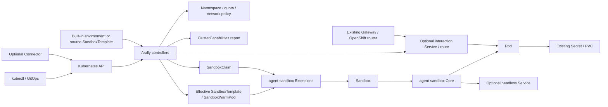

# Architecture

Arally runs three controllers in one process: AgentGroup, AgentClaim and
ClusterCapabilities. A controller-runtime manager starts them and coordinates
leader election and shutdown. Kubernetes stores their desired state and status. The
Operator runs without a backend; `connector.enabled` optionally starts an outbound
Connector worker in the same process for future Orchestrator integration.

## Resources and ownership

| Resource | Scope | Arally responsibility |
| --- | --- | --- |
| AgentGroup | Cluster | Dedicated Namespace, Pod Security labels, optional quota and NetworkPolicy |
| AgentClaim | Namespace | Agent configuration, allocation, lifecycle requests and optional HTTP access |
| ClusterCapabilities | Cluster | Runtime, storage and network configuration report |

AgentGroup creates an `arally-` Namespace and rejects unrelated existing
namespaces. Claims must be in their Group's namespace. PSA defaults to Restricted;
network isolation requires a configured NetworkPolicy and an enforcing CNI.

Users supply source templates, Secrets, PVCs and ServiceAccounts. Arally leaves
these resources unchanged. AnyUID requires administrator-granted SCC access;
the Operator has no SCC grant permissions. See [security setup](usage.md#group-namespace-and-security).

Arally owns generated templates/pools through AgentGroup, and allocation
SandboxClaims and interaction resources through AgentClaim. Extensions allocates
Sandboxes and refills pools. Core owns Pod lifecycle and, when enabled, the
headless Service. AgentClaim patches only `operatingMode` on assigned Sandboxes;
it does not create/delete Sandboxes or write Pods. Its ClusterRole grants Sandbox
patch access; Kubernetes RBAC does not restrict that permission by field.

The wire adapter uses `agents.x-k8s.io/v1beta1` for Sandbox and
`extensions.agents.x-k8s.io/v1beta1` for templates, pools and allocation Claims.
It encodes/decodes the fields Arally needs; it contains no upstream controller logic.

## Mandatory upstream pools

An AgentClaim follows this path:

1. Check Group readiness and namespace ownership.
2. Resolve a built-in environment plus runtime settings, or a source SandboxTemplate.
   Apply model, workspace and security settings, then check dependencies and capabilities.
3. Persist the configuration revision and pool selection before creating capacity.
   Generated templates and pools belong to the Group; source templates stay unchanged.
4. Create the allocation SandboxClaim. Read its assigned Sandbox reference and
   verify ownership before using Sandbox or Pod observations.
5. Reconcile the requested operating mode, optional interaction endpoint and status.

Pool identity includes Group UID, template source, resolved configuration,
selected Agent container and reference versions. Matching Claims share capacity.
Generated resources are create-only snapshots; existing external pools are
validated without adoption or modification. Administrators can change a generated
pool's spare count; Arally preserves that setting. Defaults and PVC restrictions
are in [pool policy](agent-templates.md#allocation-and-policy).

Allocation timing is saved in status, so manager restarts do not reset its budget.
Validated Sandbox assignment ends that budget; Core/Pod startup is observed
separately and does not trigger allocation-timeout cleanup. A timed-out unassigned
attempt is cleaned up and needs a new restart token. Initially suspended
Claims do not allocate until resumed. Configuration changes do not switch an
existing allocation automatically.

Group prunes generated pools and snapshots without active AgentClaim or native
SandboxClaim references, waiting for pool deletion before removing its snapshot.
Claim deletion, expiry and restart use foreground deletion of the owned
SandboxClaim; upstream controllers and garbage collection remove execution resources.
External PVCs remain. Group deletion waits for AgentClaims, Sandboxes and PVCs to
be removed before deleting its Namespace. See [lifecycle](usage.md#lifecycle).

## Reconciliation and status

Dependency watches use cache indexes to map Group, Namespace, template, ConfigMap
and PVC changes to affected Claims. Sandbox changes map through their allocation
Claim. Route/Gateway APIs use direct reads and periodic reconciliation, so optional
route CRDs are not required for manager startup.

Secrets are read by explicit reference, without listing, watching or caching.
Periodic reconciliation detects reference-version changes. The ClusterRole still
permits GET across namespaces; Group namespace checks are application logic,
not a namespace-scoped Operator RBAC installation.

ClusterCapabilities is always enabled and bootstraps the default `cluster` report.
Inventory and condition changes enqueue consumers; timestamp-only refreshes do not.
Discovery reports configuration evidence, not runtime, storage I/O or traffic tests.
See [capability checks](cluster-capabilities.md).

Pause requests on owned execution and in-flight allocation deadline checks run
before desired-configuration dependency gates. Reconciliations use bounded reads
and resume from observed state. Allocation has its own persisted budget,
configured through `claimTimeoutSeconds`.

| Condition | Meaning |
| --- | --- |
| ConfigurationAccepted | The assigned Sandbox matches the resolved configuration. |
| ConfigurationApplied | The owned Pod's creation marker and observed configuration match the desired revision. |
| CapabilityValidated | References and available cluster capability evidence were checked. |
| Ready | Current desired configuration is applied and the execution/requested endpoint are ready. |
| Available | Current Core/Pod health, independently of an unapplied configuration update. |
| ProvisioningReady | An owned Sandbox matching the selected allocation snapshot was assigned; application startup may still be pending. |
| Suspended | Current Core confirmation of suspension and no remaining execution Pod. |
| Finished | Core confirms natural completion of the current owned Pod; suspension and Pod deletion are excluded. |
| InteractionReady | Current execution availability and route-controller acceptance; not an HTTP or authentication probe. |

Status writes are skipped when unchanged; condition transitions emit Events only
after persistence. Readiness uses current-generation Core and owned Pod
observations. See [status and diagnostics](usage.md#status-and-diagnostics) for
condition interpretation and operational checks.

Configuration revisions include reference resource versions, without Secret values.
Generated Pods carry `ARALLY_CONFIGURATION_REVISION`; external warmed Pods lacking
it report unverified configuration. Drift requires an explicit restart rather than
interrupting a running Agent. Suspension removes the Pod through Core; recovery
creates a new Pod with retained PVC data, not saved process memory.

## Code organization

| Package | Responsibility |
| --- | --- |
| internal/controller | Shared ownership, condition vocabulary, Events, predicates and RBAC markers |
| internal/controller/{agentgroup,agentclaim,clustercapabilities} | CR-specific reconciliation, status and watches |
| internal/allocation | Pool selection, snapshot creation and unused-capacity cleanup |
| internal/podconfig | Creation markers and distinct declared, snapshot and admitted-Pod comparison rules |
| internal/diagnostics | Safe diagnostic messages with separately retained error causes |
| internal/sandbox | Core and Extensions wire types and encoding |
| internal/templates | Embedded environments and runtime overrides |
| internal/capabilities | Discovery catalogs, scans and report helpers |
| internal/connector | Optional CR transport for future Orchestrator integration |

The manager uses Lease leader election. When enabled, Connector runs in the same
process on the elected replica and shares its shutdown lifecycle. The chart mounts
backend credentials and grants the additional CR writes to the Operator
ServiceAccount only when `connector.enabled` is true. The relay validates requests
against its three-CR allowlist. Its transport protocol is described in
[Outbound Connector](outbound-connector.md).
