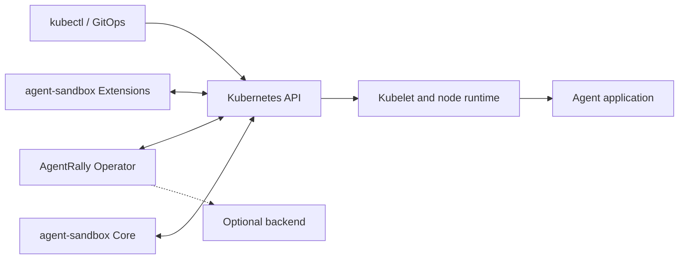
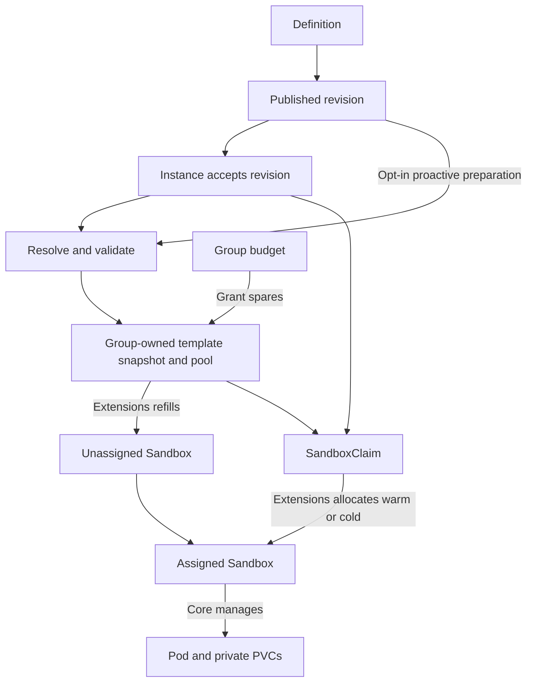

# Architecture

AgentRally manages configuration, allocation and lifecycle for containerized agents.
Applications own their conversations, model calls, tools, channels and application APIs.
An optional Orchestrator can add user identity, routing and activity policy.
It decides when to suspend or resume agents and updates their native CRs through Connector.
Direct Kubernetes and GitOps use require no backend.

## Responsibilities

A controller-runtime manager runs four controllers and the optional outbound Connector.
Leader election coordinates the active process.
Controllers reconcile their own root resources through the Kubernetes API.

| Resource | Scope | Responsibility |
| --- | --- | --- |
| AgentGroup | Cluster | Dedicated namespace, security/resource policies and shared spare-capacity budget |
| AgentDefinition | Namespace | Reusable configuration, immutable revisions and optional proactive preparation |
| AgentInstance | Namespace | Logical identity, accepted revision, workspace, lifecycle intent and HTTP access |
| ClusterCapabilities | Cluster | Advisory runtime, storage and network configuration evidence |

AgentRally publishes configuration and requests allocation.
Extensions assigns Sandboxes and refills pools.
Core manages their Pods, private PVCs and optional headless Services.
AgentRally does not duplicate those controllers or manipulate host runtime processes.

RuntimeClass selects the installed node runtime.
Kata can provide a guest VM; gVisor provides a userspace kernel.
Their handlers, hardware and workload compatibility remain cluster prerequisites.
Containers in one Pod sandbox share its isolation boundary.

## Provisioning and prewarming

One Definition can serve multiple Instances.
Publication and allocation use distinct identities:

| Identity | Includes | Purpose |
| --- | --- | --- |
| Published revision | Normalized Definition and source template | Immutable application configuration accepted by Instances |
| Effective fingerprint | Resolved Pod settings, selected container, reference versions and source/workspace/Definition UIDs | Match generated snapshots, pools and allocations |

Secret values are not copied into revisions or fingerprints.
Reference rotation can change the effective fingerprint without publishing a new application revision.
Replica-count changes do not publish an application revision.

Allocation proceeds as follows:

1. Validate Group readiness and namespace UID.
2. Accept a revision and resolve references, security, storage and capability checks.
3. Persist the selected revision and pool before creating shared capacity or a Claim.
4. Create the Claim when allocation is permitted.
5. Verify the assigned Sandbox's ownership and selected configuration.
6. Request operating mode and observe Core, the Pod and optional access resources.

Warm and cold allocation use the same Claim path.
Matching Instances can share a pool within a Group, while each assigned Sandbox keeps its private PVCs.
External pools remain user-managed and must reference a matching Group-owned snapshot.
Arbitrary unmarked templates cannot establish allocation identity.

Managed pools start with zero spares.
Group policy can refill Instance-discovered configurations and retain idle capacity for a TTL.
Definition preparation additionally needs explicit Definition demand and Group authorization.
The Group grants bounded fair shares and reduces retiring targets before increasing replacements.
ResourceQuota bounds actual namespace use; desired spare budgets are not instantaneous physical counts.

Proactive Definition preparation currently accepts long-running stateless configurations with readiness probes.
It rejects PVCs, direct data volumes and Kubernetes ServiceAccount tokens.
Instance-discovered pools can prepare fresh private PVCs per spare.
External workspace bindings stay cold.
A spare runs the real application before assignment, including its configured credentials and startup side effects.

Definition Ready means publication succeeded.
Prepared means the Group granted the requested capacity and the current native pool reports it ready.
Neither reserves a warm allocation for a particular caller.
Dependency rotation retires old targets while allocated references protect their snapshots.
Allocation pause stops new submissions and drains proactive spare targets; upstream work already submitted can finish.
See [prewarming policy](agent-templates.md#allocation-and-policy).

## Resources and ownership

| Resource | Reconciled by | Controller owner |
| --- | --- | --- |
| Namespace and policies | AgentRally | AgentGroup |
| Published revisions | AgentRally | AgentDefinition |
| Effective snapshots and pools | AgentRally | AgentGroup |
| Allocation Claim, access Service and route | AgentRally | AgentInstance |
| Unassigned Sandbox | Extensions | SandboxWarmPool |
| Assigned Sandbox | Extensions | SandboxClaim |
| Execution Pod, private PVCs and headless Service | Core | Sandbox |

Groups reject unrelated existing namespaces.
Source templates, external pools, credentials and external PVCs remain user-managed.
UID checks prevent same-name replacements from being accepted as original resources.

Pruning reads current Instance, Definition and native Claim references.
It uses UID/resource-version preconditions and waits for pool deletion before deleting a snapshot.
Group deletion bypasses idle retention but still respects active references.
Instance restart, expiry and deletion request foreground Claim cleanup.
Definition deletion waits for referencing Instances; Group deletion waits before removing its namespace.

## Lifecycle and workspace

Logical Instance UID, allocated Sandbox UID and running container identity have different lifetimes.
Suspend/resume removes and recreates the Pod while retaining the Sandbox.
Changing `restartToken` replaces the allocation after cleanup.
A Definition update alone does not upgrade accepted Instances.
Explicit upgrades select `spec.revision` and a new replacement token.

| Storage | Suspend/resume | Execution replacement or Instance deletion |
| --- | --- | --- |
| Ephemeral files | Lost with the Pod | Lost |
| Execution-private PVC | Same PVC | Deleted with the Sandbox; replacement gets new storage |
| External PVC | Same PVC | Retained; same-Instance replacement reuses its pinned binding |

External RWX sharing needs application-level concurrency control.
Optional exclusive reservation Leases coordinate Operator-managed consumers and survive replacement.
They do not fence nodes or other writers.
VolumeSnapshot sources initialize private PVCs through CSI; they do not restore process memory or a microVM checkpoint.

Shutdown deadlines and maximum lifetime include suspension.
Completion TTL starts after confirmed natural completion of the current owned execution.
`shutdownPolicy: Retain` keeps the logical Instance and diagnostics while removing execution.
Storage follows the table above.
Operating commands are in [Lifecycle](usage.md#lifecycle).

### Reconciliation and status

Controllers derive decisions from current state and persist status only on semantic changes.
Selections and identity pins precede side effects.
Stop requests and in-flight deadlines are handled before new-configuration dependency gates.

Published Definitions without proactive demand wait for Group/template events.
Prepared capacity, credential references and read-only upstream observations also use bounded polling.
Indexes route dependency events without performing remote reads inside handlers.
Controllers read Secrets by explicit reference, bypassing the informer cache.
Enabling Connector adds Secret list/create/delete permissions for its restricted management interface.
ConfigMap create/delete permissions are also gated by Connector; existing Controller reads and watches are retained.
Remote reads negotiate metadata only and never fall back to Secret content.

Conditions distinguish allocation, configuration application, health and desired intent.
Available follows current execution health.
Ready additionally requires the desired configuration and requested endpoint.
Suspended requires current Core confirmation and no remaining owned Pod.
A terminating Pod keeps cleanup pending; the Operator reports stalls rather than force-deleting runtime resources.
See [status and diagnostics](usage.md#status-and-diagnostics).

Pod removal intent, transport cancellation and container observations do not prove an unreachable writer has stopped.
The invocation protocol exposes this uncertainty.

## Access and trust

Kubernetes RBAC governs control requests.
Application traffic has separate routing and authentication.
Optional HTTP access uses a UID-bound Service and an accepted route.
NetworkPolicy configuration requires a suitable CNI; policies are additive.

ClusterCapabilities observes runtime/storage/network configuration and freshness.
It does not attest execution, storage I/O or filtering.
See [capability evidence](cluster-capabilities.md).

The optional Connector runs inside the elected Operator and initiates outbound HTTPS.
It relays scoped Kubernetes management operations and exposes container-level observations.
Authentication and caller authorization belong to the backend.

Invocation is a default-off preview with pinned execution targets and bounded JSON/SSE transport.
Production invocation and exclusive handoff remain unadvertised.
Real backend conformance and combined-load verification are rollout gates.
See [Connector setup](outbound-connector.md) and the [invocation contract](invocation-protocol.md).

## Code organization

| Directory | Purpose |
| --- | --- |
| `api`, `chart` | Typed CR contracts and generated installation manifests |
| `internal/controller` | Root reconcilers, resource ownership and condition/event handling |
| `internal/executionconfig`, `podconfig` | Shared creation-input resolution and comparisons with native defaults/admission |
| `internal/definition`, `allocation` | Revision publication and capacity/Claim selection |
| `internal/sandbox` | Core/Extensions wire adapter, without upstream controller logic |
| `internal/capabilities` | Passive discovery and classification catalog |
| `internal/connector` | Optional management and invocation transports |
| `internal/diagnostics`, `metrics` | Safe diagnostic projection and bounded observations |
| `config/rbac`, `examples` | Deployer grants and basic/full CR references |

## Support and verification boundaries

Unit tests check decisions; envtest checks API contracts and admission.
Kind exercises actual Core/Extensions and Kubernetes GC.
Runtime/CNI/CSI tests establish only the installed versions and paths tested.
No layer substitutes for another.
Build commands and reproducible verification are in [Development](development.md).
